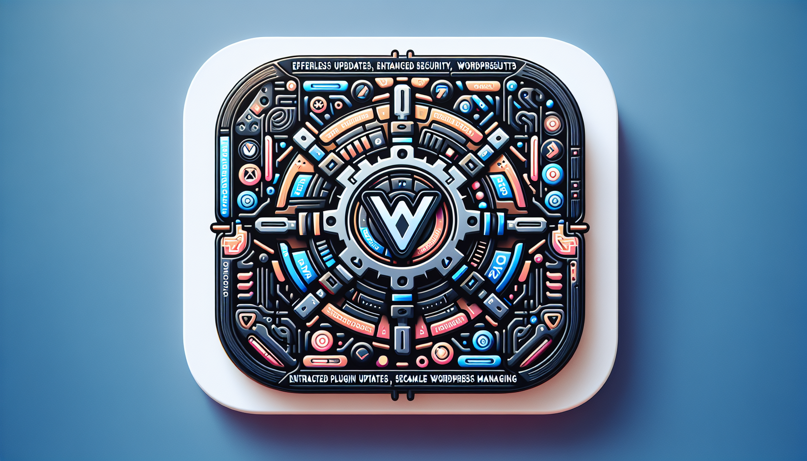

<div id="top">

<!-- HEADER STYLE: CLASSIC -->
<div align="center">



# V-WORDPRESS-PLUGIN-UPDATER

<em>Seamless Updates, Limitless Innovation, Unmatched Control</em>

<!-- BADGES -->


<em>Built with the tools and technologies:</em>


</div>
<br>

---

## Table of Contents

1. [Table of Contents](#table-of-contents)
2. [Overview](#overview)
3. [Features](#features)
4. [Project Structure](#project-structure)
5. [Getting Started](#getting-started)
6. [Roadmap](#roadmap)
7. [License](#license)

---

## Overview

The V-WordPress-Plugin-Updater is a **dual-component system** designed to streamline WordPress plugin and theme updates through a centralized management approach:

1. **Update API Server** (`v-update-api/`): A standalone PHP web application that hosts and serves plugin/theme update packages. Built with a modern MVC architecture using FastRoute for routing, Doctrine DBAL for SQLite database management, and comprehensive security features including encrypted API keys, IP blacklisting, and session management.

2. **WordPress Client Plugin** (`v-wp-updater/`): A WordPress plugin that automatically checks for and installs updates from the API server. It integrates with WordPress core update mechanisms, providing scheduled daily checks, a dashboard settings widget for configuration, and plugin-side update logging.

This architecture enables centralized control over plugin and theme updates across multiple WordPress installations, reducing manual maintenance overhead while maintaining security and reliability. The API server provides a web-based admin interface for managing authorized hosts, packages, and update logs.

---

## Features

|      | Component            | Details                                                                                     |
| :--- | :------------------- | :------------------------------------------------------------------------------------------ |
| ⚙️  | **Architecture**     | <ul><li>Dual-component system: standalone Update API server + WordPress client plugin</li><li>MVC architecture with FastRoute routing and Doctrine DBAL</li><li>Separate namespaces: `App\` (server) and `VWPU\` (client)</li></ul> |
| 🔩 | **Code Quality**     | <ul><li>PSR-12 coding standards for API server</li><li>WordPress Coding Standards for client plugin</li><li>PHPStan static analysis at level 6</li><li>PHPUnit tests currently cover router dispatch/guards and secure random-byte generation</li></ul> |
| 📄 | **Documentation**    | <ul><li>Detailed README with installation and usage instructions</li><li>Inline PHPDoc comments throughout codebase</li></ul> |
| 🔌 | **Integrations**      | <ul><li>WordPress hooks and filters integration</li><li>Cron-based synchronization between filesystem and database</li></ul> |
| 🧩 | **Modularity**        | <ul><li>Separate API, login, home/host, plugin, theme, and log controllers</li><li>Helpers provide encryption, validation, and messages; models handle filesystem synchronization and database operations</li><li>Router guards enforce blacklist, session, and CSRF checks</li></ul> |
| 🧪 | **Testing**           | <ul><li>Checked-in PHPUnit tests cover router dispatch, router guards, and secure random-byte generation</li><li>The current suite does not provide comprehensive test coverage for both components</li></ul> |
| ⚡️  | **Performance**       | <ul><li>SQLite database for update metadata</li><li>Daily cron synchronization of plugin/theme ZIP metadata and blacklist cleanup</li><li>Client reuses the ZIP body fetched during a successful update check rather than downloading it a second time</li></ul> |
| 🛡️ | **Security**          | <ul><li>Encrypted API keys using AES-256-GCM (with legacy ciphertext migration)</li><li>IP-based blacklisting for repeated authentication failures</li><li>Session timeout and user agent validation</li><li>CSRF protection on non-API forms</li><li>Input validation and sanitization</li></ul> |
| 📦 | **Dependencies**      | <ul><li>PHP 8.2+ for `v-update-api` and PHP 8.0+ for `v-wp-updater`</li><li>Composer packages: FastRoute, Doctrine DBAL, Respect/Validation</li><li>WordPress core functions for client plugin</li><li>Web server with PHP support (Apache/Nginx)</li></ul> |

---

## Project Structure

```sh
└── v-wordpress-plugin-updater/
    ├── .github/
    │   └── copilot-instructions.md
    ├── LICENSE
    ├── README.md
    ├── tests/
    ├── v-update-api/                         # Update API server
    │   ├── app/
    │   │   ├── Controllers/                 # API, login, home/host, plugin, theme, and log routes
    │   │   ├── Core/                        # Request, Response, Router, session, database, and errors
    │   │   │   ├── DatabaseManager.php
    │   │   │   ├── ErrorManager.php
    │   │   │   ├── Request.php
    │   │   │   ├── Response.php
    │   │   │   ├── Router.php
    │   │   │   └── SessionManager.php
    │   │   ├── Helpers/                     # Encryption, validation, and messages
    │   │   ├── Models/
    │   │   └── Views/
    │   ├── public/
    │   │   ├── index.php
    │   │   └── install.php
    │   ├── storage/                         # SQLite database, logs, and package storage
    │   ├── composer.json
    │   ├── config.php
    │   └── cron.php
    └── v-wp-updater/                        # WordPress client plugin
    │   ├── helpers/
    │   ├── services/
    │   ├── widgets/
    │   ├── install.php
    │   ├── uninstall.php
    │   └── v-wp-updater.php                # Main plugin file
```

---

## Getting Started
**System Requirements:**

* **PHP**: version 8.2 or higher for `v-update-api/`; version 8.0 or higher for `v-wp-updater/`
* **Web Server**: Apache, Nginx or any server capable of running PHP
* **Write Permissions**: ensure the web server can write to `v-update-api/storage/`

### Installation

#### Update API Server Setup

1. Clone or download this repository to your web server.
2. Set `v-update-api/public/` as your web server document root.
3. Create the following directories so the Update API can store packages and logs:

   ```sh
   mkdir -p v-update-api/storage/plugins
   mkdir -p v-update-api/storage/themes
   mkdir -p v-update-api/storage/logs
   ```

4. Edit `v-update-api/config.php` and replace the default `VALID_USERNAME`, `VALID_PASSWORD`, and `ENCRYPTION_KEY` values with deployment-specific secrets. The admin password is compared as configured (not as a password hash). Keep this file private and adjust `LOG_FILE` or storage paths only when needed.
   The Update API requires PHP 8.2 or higher.

5. Set a private, deployment-specific `ENCRYPTION_KEY` in `v-update-api/config.php`; it is used to encrypt stored host API keys with AES-256-GCM:

	```sh
   php -r "echo bin2hex(random_bytes(32)), PHP_EOL;"
   ```

   Copy the generated value into the `ENCRYPTION_KEY` constant in `v-update-api/config.php`. Keep it backed up securely; existing stored keys cannot be decrypted if this value is lost or changed.

6. Ensure the web server user owns the `v-update-api/storage/` directory so uploads and logs can be written. Application logs are written to `LOG_FILE` (default `v-update-api/storage/logs/app.log`).

7. Run `php v-update-api/public/install.php` from the repository root, or visit `/install.php` on the API server, to create the SQLite database and required tables. Ensure `v-update-api/storage/` is writable by the web server.

8. Configure a system cron to run once daily (the script is CLI-only and takes no arguments):

   ```sh
	0 2 * * * cd /path/to/v-update-api && php cron.php
   ```

	This keeps the database in sync with plugin and theme ZIP files in the storage directories and also cleans up expired blacklist entries. The script is CLI-only and accepts no worker argument.

#### WordPress Client Plugin Setup

1. Copy the `v-wp-updater/` directory to your WordPress installation's `wp-content/plugins/` directory.

2. Configure the API server URL and API key in WordPress using the dashboard settings widget or via provisioning:

   ```php
   update_option('vwpu_update_plugin_url', 'https://updates.example.com/api');
   update_option('vwpu_update_theme_url', 'https://updates.example.com/api');
   update_option('vwpu_update_key', 'your-api-key-from-server');
   ```

   Alternatively, navigate to the WordPress Dashboard → Settings widget (V WordPress Updater Settings) after activation to configure these values via the admin UI.

3. Activate the plugin through the WordPress admin panel or WP-CLI.

4. The plugin schedules daily update checks for plugins and themes. Enable each update type in the dashboard widget before that updater runs; both are disabled by default.

**Note:** When a host entry is created or its key regenerated in the Update API admin panel, update the client installation with the new key using your provisioning process.

### Usage

#### Managing the Update API Server

1. Log in to the Update API admin panel by visiting `https://your-update-server.com/login` using the credentials configured in `v-update-api/config.php`.

2. **Manage Hosts**: Add authorized WordPress domains and generate API keys in the `/home` route.

3. **Upload Plugins**: Navigate to `/plupdate` to upload plugin ZIP files. Files must be named following the pattern `{slug}_{version}.zip` (e.g., `my-plugin_1.2.3.zip`).

4. **Upload Themes**: Navigate to `/thupdate` to upload theme ZIP files. Files must follow the same naming pattern as plugins.

5. **View Logs**: Check `/logs` for plugin and theme update activity logs.

6. The daily cron job will automatically sync uploaded files to the database. Ensure the cron job is configured as described in the installation steps.

#### Using the WordPress Client Plugin

Once activated, the V WordPress Plugin Updater automatically:

- Runs scheduled daily checks for enabled plugin and theme updates
- Contacts the Update API server to check for available updates
- Downloads and installs updates when newer versions are available
- Records update activity through the plugin logger

Configure the plugin through the **V WordPress Updater Settings** dashboard widget. Update activity logs for hosts and API requests are available in the Update API server's `/logs` page.

---

## API Specification

For the complete endpoint contract, parameter validation, request example, response codes, package naming, and security notes, see the [Update API Reference](./API.MD).

---

## Roadmap

- [X] **`Task 1`**: <strike>Convert to MVC framework</strike>
- [X] **`Task 2`**: <strike>Implement more advanced authorization for site connections</strike>
- [X] **`Task 3`**: <strike>Implement Database instead of useing filesystem</strike>
      
---

## License

V-wordpress-plugin-updater is protected under the [LICENSE](https://choosealicense.com/licenses) License. For more details, refer to the [LICENSE](https://choosealicense.com/licenses/) file.

---
